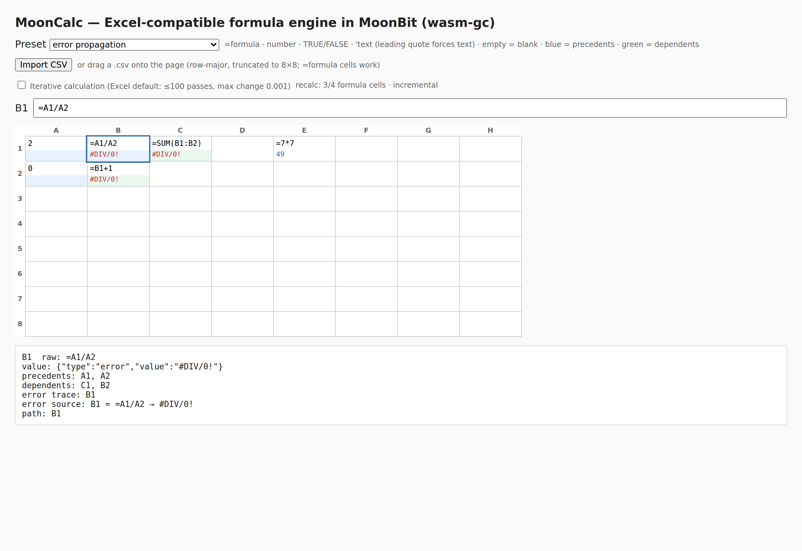
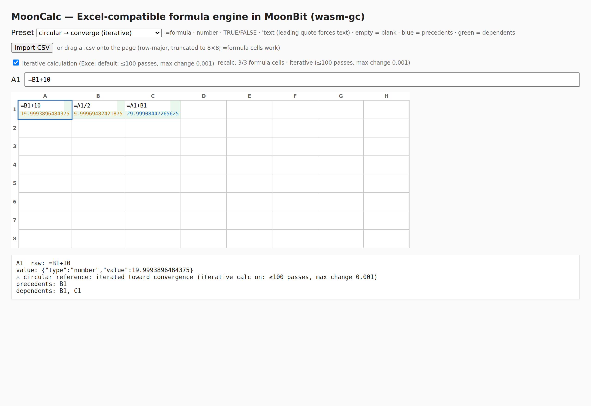

# MoonCalc

**Excel 兼容的电子表格公式引擎，用 MoonBit 编写。**

> 状态（2026-11-17，M8 完成）：60 函数引擎（**MoonBit**）＋**核心引用语义**（跨表 `Sheet!A1`、工作簿级定义名称、整列整行 `A:A`/`2:2`，ADR 0008）、native CLI、wasm-gc playground、mbtexcel 读→算→写示例（**多表**版）；AST 缓存（热态约 2.6×）、增量重算（改一格 5×）、可选迭代计算、错误解释 API（explain + 依赖图）。**真实 Excel 答案键语料 1,267/1,267（100%）**（桌面 Excel 2024 · 16.0.20527.20196 · zh-CN 生成；2 条奇数参数 IFS + 3 条非法/重复定义名称被 Excel 拒绝录入，显式标为子集外；5 条超出声明子集的探针另存 `corpus/excluded/` 不计分），无未归因失败：1,247 精确命中 + 3 clock-tolerance + 16 excel-precision + 1 surrogate-representation。另有 12 条 M8 语义探针（`corpus/probes/`）与 mbtexcel 0.3.2 的差分对照（[docs/comparison-mbtexcel.md](docs/comparison-mbtexcel.md)）。2026 MoonBit 年度黑客松 11 月赛参赛项目。

## 这是什么

MoonCalc 接收一组单元格——每个单元格承载字面值或公式——按 Excel 语义求值并返回结果或错误值。它不读写 `.xlsx` 文件，文件读写交给 mbtexcel 这类工具，MoonCalc 只负责计算。

项目走“窄而深”的路线：实现 60 个核心函数，覆盖逻辑、文本、数学、统计、查找、日期六族；每个函数的弱类型强制转换、错误值传播和边界情形都要严格对照真实 Excel。正确性用真实 Excel 生成的答案键语料逐条验证，对外公开用例数和通过率，未通过的用例逐条归因。

## 浏览器演示

在线 playground（push main 自动部署）：<https://buguoshixc.github.io/mooncalc/>



错误传播 + explain 上溯：选中错误格 B1，详情面板给出传播链与错误源；改 A1 后只重算下游 3 个公式格（计数器 `3/4 · incremental`，无关的 E1 不重算）。



勾选「Iterative calculation」（Excel 默认 ≤100 次、最大变化 0.001），循环引用从 0 收敛到 ≈20/≈10；取消勾选回到 Excel 默认（环上 = 0）。

## 快速开始

```bash
export PATH="$HOME/.moon/bin:$PATH"

# 全量验证：双目标构建 + 159 项单测 + 零 IO 守卫
bash scripts/check.sh

# CLI：求值一个含引用链/错误传播/循环引用的网格
moon build --target native
_build/native/debug/build/buguoshixc/mooncalc/cmd/main/main.exe eval --grid tests/fixtures/grid.json

# 跑分：真实 Excel 权威语料（默认 corpus/cases）
bash scripts/run-bench.sh

# 性能基准：进程内大网格重算（默认 1 万格，见 docs/performance.md）
moon build --target native --release
_build/native/release/build/buguoshixc/mooncalc/cmd/main/main.exe perf --cells 100000

# 浏览器 playground（wasm-gc）：支持 CSV 拖拽/按钮导入（行主序，=公式格可直接算）
bash scripts/build-playground.sh
(cd playground && python3 -m http.server 8080)   # 打开 http://localhost:8080/

# headless Chromium 冒烟（39 断言，零 npm 依赖）
node scripts/smoke.mjs
```

在线 playground 已部署 GitHub Pages：<https://buguoshixc.github.io/mooncalc/>（push main 自动构建部署，见 [.github/workflows/pages.yml](.github/workflows/pages.yml)）。

### XLSX 读 → 算 → 写（示例壳，核心零改动）

[examples/xlsx-demo](examples/xlsx-demo/) 演示与 `moonbitlang/mbtexcel` 组合的完整链路（M8 多表版）：3 个工作表 + 工作簿级名称，mbtexcel 读 xlsx → 按 `SHEET!A1` 契约组装网格 → MoonCalc 进程内求值（跨表/名称/整列整行）→ 按宿主表回写缓存值 → 逐表读回断言 65 项。文件 IO 只发生在示例壳层，引擎本体保持纯计算。

```bash
export PATH="$HOME/.moon/bin:$PATH"
moon run examples/xlsx-demo --target native -- gen   # 生成 fixture _build/xlsx-demo/input.xlsx
moon run examples/xlsx-demo --target native -- run   # 3 表读→算→写 output.xlsx，并逐表读回断言
# xlsx-demo verification PASS: 65/65 (formula + cached value + literal + expected-result checks)
```

完整演示脚本见 [docs/demo.md](docs/demo.md)。

## 作为 mooncakes 库使用

已发布：[mooncakes.io/buguoshixc/mooncalc](https://mooncakes.io/buguoshixc/mooncalc)（0.3.0；M8 版 0.4.0 已就绪、`moon publish --dry-run` 通过，API 文档由平台依据 `///` 注释自动生成）。

```bash
moon add buguoshixc/mooncalc
```

在包清单 `moon.pkg` 中 import：

```moonbit
import {
  "buguoshixc/mooncalc" @mooncalc,
}
```

最小用法（内存网格 → 重算 → 读结果；文件 IO 与时钟注入由调用方负责）：

```moonbit
fn main {
  let grid = @mooncalc.new_grid()
  grid.cells["A1"] = @mooncalc.Cell::Literal(@mooncalc.Value::Num(6.0))
  grid.cells["B1"] = @mooncalc.Cell::Formula("=A1*7")

  // now: None 时 TODAY/NOW 按契约返回 #NUM!；需要时钟时传入 Excel 序列日。
  let out = @mooncalc.recalc(grid, { now: None })
  match out.cells.get("B1") {
    Some(r) => println(r.value) // Num(42)
    None => println("missing")
  }
}
```

- `eval_formula(formula, grid, options)`：单公式求值；解析失败走 `Result` 的 `Err` 通道，求值错误值（如 `#DIV/0!`）作为 `Value::Err` 返回。
- `eval_at(addr, grid, options)`：求值单个单元格。
- `recalc(grid, options)`：整网格按依赖关系重算，循环引用复刻 Excel 默认（环上为 0，`circular: true`）。
- `recalc_cached(grid, options, cache)`：同 `recalc`，复用调用方持有的 `ParseCache`（按公式全文缓存 AST），交互式编辑场景热态约 2.6×（记录值 2.65×，见 [docs/performance.md](docs/performance.md)）。
- `recalc_init` / `recalc_update`：增量重算——改一格只重算下游闭包，输出与全量逐字段一致（环/解析错误自动回退全量），10 万格改一格约 5×。`recalc_update_report` 另返回重算元数据（重算公式格清单 + 是否回退全量），playground 的「本次重算 N/M 格」计数器即由此驱动。
- `recalc_iterative` / `eval_formula_iterative`：可选迭代计算（对齐 Excel「启用迭代计算」，默认 100 次/0.001），默认路径不变。
- `eval_at_key(key, grid, options)` / `explain_at_key(key, grid, options)`：M8 限定键入口，`key` 形如 `SHEET!A1`（默认表用裸 `A1`），与 `eval_at`/`explain` 等价但可直接寻址跨表格。
- `Grid.names`：工作簿级定义名称（`Map[String,String]`，ASCII 大写名 → 引用文本），随网格一起传入；跨表引用、名称与整列整行由解析器/求值器直接支持（ADR 0008）。
- `explain(addr, grid, options)`：错误解释——贡献性错误传播路径（最左错误规则感知）与错误源头；`dependency_graph(grid)` 提供 AST 级依赖图；跨表/名称/整列整行等不可枚举依赖按 `oversized` 降级披露。
- 完整 API 见 [pkg.generated.mbti](pkg.generated.mbti)；发布后 mooncakes 会依据 `///` 文档注释自动生成 API 文档。

## 正确性指标（诚实口径）

| 层 | 数字 | 性质 |
|---|---|---|
| 单元/快照测试 | 159/159 | 手写期望（引擎语义回归 + codec + 语法 + bench 桶 + 限制边界 + 确定性 fuzz + 增量等价 + 迭代 + explain） |
| 过渡语料 bench | 34/34（100%） | source: manual，**非权威**，仅证明流程 |
| 用例规格 | 1,277 条（corpus/spec/，每函数 ≥15 + M8 refs 批 106） | 1,272 条已生成权威答案键（2 条奇数参数 IFS + 3 条非法/重复定义名称被 Excel 拒录）；其中 5 条超出声明子集或属非稳态，另存 `corpus/excluded/`，验收分母 1,267 |
| **真实 Excel 语料** | **1,267/1,267（100%）** | 桌面 Excel 为唯一裁判；1,247 match + 3 clock-tolerance + 16 excel-precision + 1 surrogate-representation，0 条未归因失败，见 `corpus/reports/real.json`；M8 refs 批（98 条）含跨表/名称/整列整行 |

比较策略：默认精确相等；**15 位有效数字表征差**（相对差 ≤1e-14）单列 `excel-precision` 桶并通过（源头是 Excel/VBA 只能以 15 位十进制序列化答案）；`clock` 用例按**绝对天数**容差（`--clock-tol`，默认 1e-6 天）单列 `clock-tolerance` 桶并通过（`now` 由生成器在同一重算里经 `=NOW()` 辅助格捕获）；**孤代理对表征差**（VBA 将 REPLACE 半代理对切割产生的孤代理对序列化为 U+FFFD）单列 `surrogate-representation` 桶并通过；相对差 <1e-9 仍单列 `numeric-tolerance` 桶计失败并归因。权威报告：`corpus/reports/real.json`。

## 设计要点

- **纯计算核心，不做任何 IO**：同一份核心同时编译到 native 和 wasm-gc；`scripts/check.sh` 机械守卫（双目标构建 + grep 禁 `@fs`/`@sys`/`println`）。native 侧跑答案键语料对照，wasm-gc 侧做浏览器 playground。
- **输入是内存网格契约**：单元格网格是唯一数据契约，JSON 序列化跨进程传递；CLI 与 wasm 导出共用同一 codec。
- **函数子集是公开契约**：子集外行为显式约定（未知函数 `#NAME?`、TEXT 子集外 `#VALUE!`），见 [docs/semantics.md](docs/semantics.md)。
- **核心不读系统时钟**：`TODAY`/`NOW` 由调用方注入 `now`（未注入 → `#NUM!`），同一份语料任何时候跑出同样结果。
- **循环引用复刻 Excel 默认**（迭代关闭）：环上单元格 = 0，元数据标 `circular:true`；循环定义名称按真实 Excel 答案键返回 `#NAME?`（不返回 0）。
- **M8 核心引用语义**：跨表引用/区域 `Sheet!A1`、带引号表名、工作簿级定义名称、整列整行按 used-range 展开（不静默截断；缺表 `#REF!`）；增量/解释对不可枚举依赖显式回退并披露（ADR 0008）。
- **离线、确定性**：不调用模型 API 或网络服务，适合放进 CI 做回归对照。
- **不崩溃保证**：复刻 Excel 公式限制（≤8192 字符、≤64 层嵌套），超限返回 `ParseError`；长二元链迭代求值，任何输入在 native 与 wasm-gc 上都不会栈溢出（边界回归 + 确定性 fuzz 守卫）。

## 函数子集（60，已全部实现）

| 族 | 函数 |
| --- | --- |
| 逻辑 | IF、IFS、SWITCH、AND、OR、NOT、IFERROR、XOR |
| 文本 | LEFT、RIGHT、MID、LEN、TRIM、UPPER、LOWER、CONCAT、TEXTJOIN、TEXT、VALUE、FIND、SUBSTITUTE、REPLACE、SEARCH、PROPER |
| 数学 | ROUND、ROUNDUP、ROUNDDOWN、ABS、INT、MOD、POWER、SQRT、SUM、SUMIF、SUMPRODUCT、CEILING、FLOOR |
| 统计 | AVERAGE、COUNT、COUNTA、COUNTIF、MIN、MAX、MEDIAN、STDEV、VAR、PERCENTILE |
| 查找 | VLOOKUP、XLOOKUP、HLOOKUP、INDEX、MATCH、CHOOSE |
| 日期 | DATE、EOMONTH、YEAR、MONTH、DAY、TODAY、NOW |

逐函数状态与用例数：[docs/support-matrix.md](docs/support-matrix.md)。已实现的语义细节（强制转换三表、比较排序、错误传播顺序、Lotus 日期 bug、TEXT 子集、语料裁定项）：[docs/semantics.md](docs/semantics.md)。

## 仓库状态

- [x] 仓库初始化（README / LICENSE / .gitignore）
- [x] 设计与决策记录（`docs/adr/0001`–`0006`）
- [x] 项目申报书（[项目申报书.md](项目申报书.md)）
- [x] 公式解析与求值核心（Pratt 解析器、Excel 优先级、记忆化重算、环检测）
- [x] 首批 45 函数实现（含十进制舍入修正、双通道强制转换、时钟注入）
- [x] 答案键语料 schema + VBA 生成器 + 1,003 条用例规格 + 对照 CLI（eval/bench）
- [x] wasm-gc playground（8×8 网格、语义预设、引擎级依赖图/错误上溯（explain API）、CSV 拖拽导入、迭代计算开关 + 增量重算 N/M 计数器、headless 冒烟 39 断言 PASS）
- [x] 文档与支持矩阵（semantics / support-matrix / demo / toolchain）
- [x] 真实 Excel 语料接入与 M5 对照修复（Excel 2024 生成 752 条、0 跳过；M5 基线 752/752 通过，见 [corpus/cases/PROVENANCE.md](corpus/cases/PROVENANCE.md)）
- [x] M5 修复循环完成：36 条差异逐条归因/修复（11 条时钟、24 条语义、1 条 15 位表征），
      重跑 M5 基线 bench 752/752 并更新 `corpus/reports/real.json`
- [x] README/支持矩阵权威 N/X% 替换基线数字
- [x] M6：CI（核心门禁 + 独立 headless smoke job）与 mooncakes 发布准备
- [x] M6：`examples/xlsx-demo`（mbtexcel 读→算→写，核心零改动）
- [x] M6：函数 45→50（XLOOKUP、IFS、SWITCH、TEXTJOIN、EOMONTH）+ 75+ 条新规格用例
- [x] M6：TEXT 加深（E+/E- 科学计数、[h]/[m]/[s] 累计时长、[>100] 条件分段）+ criteria 边界语料
- [x] M6：桌面 Excel 2024 生成新增答案键 → bench 修复循环（1,001/1,001，2 条 Excel 拒录 IFS 显式子集外）
- [x] M6：playground 依赖图/错误上溯/新预设（smoke 20 断言）
- [x] 健壮性加固：Excel 公式限制（8192 字符/64 层嵌套）+ 长链迭代求值，修复超长/超深公式段错误；边界回归 + 确定性 fuzz（88 项单测）
- [x] 公开 API 文档补全（全部 pub 类型/构造器/字段/方法 /// 注释）
- [x] 性能基准：`perf` 子命令（4 场景 × 10 万格线性扩展）+ 区域缓存优化（shared 2.2×），见 [docs/performance.md](docs/performance.md)
- [x] M7：公式 AST 缓存（`recalc_cached`，opt-in 零回归；dup 6.5× / repeat 热态 2.65×）+ perf 新增 dup/repeat/edit/edit-chain 场景
- [x] M7：增量重算（`recalc_init`/`recalc_update`，输出与全量逐字段一致，环/解析错误自动回退；10 万格改一格 5.2×）+ 500 轮确定性等价 fuzz
- [x] M7：可选迭代计算（`recalc_iterative`/`eval_formula_iterative`，Excel 默认 100 次/0.001；spec 第 6 列 + VBA 生成器迭代支持 + 18 条规格）
- [x] M7：错误解释 API（`explain` 贡献性探针 + `dependency_graph`；CLI explain、wasm explain_json、playground 迁移引擎图，smoke 24 断言）
- [x] M7：函数 50→60（ADR 0007：STDEV/VAR/PERCENTILE/REPLACE/SEARCH/PROPER/CEILING/FLOOR/CHOOSE/XOR）+ 150 条规格（答案键已生成，计入 1,169/1,169 对照）
- [x] M7 展示准备：版本 0.3.0、mbtexcel 剥离至 examples 子模块（moon.work workspace，发布包仅依赖 x）、`moon publish --dry-run` 通过、GitHub Pages workflow（CI 构建 wasm）、playground CSV 拖拽/按钮导入
- [x] M7 可视化：wasm `recalc_incremental_json`（增量状态持于壳层，核心保持无状态）+ `recalc_update_report` 元数据 API；playground 迭代计算开关、循环收敛预设、增量 N/M 计数器；README 演示截图
- [x] M8：核心引用语义（跨表/带引号表名/定义名称/整列整行；`Grid.names`、`eval_at_key`、`explain_at_key`、CLI `--names`）+ ADR 0008
- [x] M8：答案键语料 refs 批（桌面 Excel 生成 103/106，裁定后 98 条进分母；1,267/1,267）+ 12 条语义探针 + mbtexcel 0.3.2 差分报告（`corpus/reports/mbtexcel.json`，1,267 条）
- [x] M8：`examples/xlsx-demo` 多表版（3 表 + 定义名称，读→算→写 65/65 断言）；comparison 文档、申报书与 README 数字同步

## 语料生成（用户侧动作）

权威语料已由桌面 Excel 生成并放入 `corpus/cases/`（**1,267 条**；旧 8 文件 1,169 条 + M8 refs 批 98 条。2 条奇数参数 IFS 与 3 条非法/重复定义名称被 Excel 拒绝录入，见 `corpus/cases/logic.skipped.txt`、`refs.skipped.txt`；5 条超出声明子集的探针另存 `corpus/excluded/`；来源、版本与 SHA-256 见 [corpus/cases/PROVENANCE.md](corpus/cases/PROVENANCE.md)）。重新生成时在桌面 Excel 运行 [corpus/excel/generate_corpus.bas](corpus/excel/generate_corpus.bas)：全量用 `GenerateCorpus`，单批（如 `corpus/spec/refs.tsv`）用 `GenerateCorpusOne`（说明见 [corpus/excel/README.md](corpus/excel/README.md)），把导出的 JSON 放入 `corpus/cases/`，然后：

```bash
_build/native/debug/build/buguoshixc/mooncalc/cmd/main/main.exe bench --corpus corpus/cases --report corpus/reports/real.json
```

## 设计文档

- [ADR 0001：放弃 MoonPack，转向电子表格公式引擎](docs/adr/0001-pivot-to-formula-engine.md)
- [ADR 0002：产品边界为纯引擎库加薄 CLI，不碰 XLSX 文件](docs/adr/0002-engine-only-boundary.md)
- [ADR 0003：窄而深，限定函数子集，逐个严格对照 Excel](docs/adr/0003-narrow-and-deep-conformance.md)
- [ADR 0004：纯计算核心 + 薄 IO 壳，引擎支持全后端](docs/adr/0004-pure-core-thin-io-shell.md)
- [ADR 0005：新建 mooncalc 仓库，moonpack 归档](docs/adr/0005-new-mooncalc-repo.md)
- [ADR 0006：函数子集取通用表格自动化口径，约 50 个](docs/adr/0006-general-purpose-function-subset.md)
- [ADR 0007：函数 50→60（统计/文本/数学/查找族扩列）](docs/adr/0007-function-subset-expansion.md)
- [ADR 0008：M8 核心引用语义（跨表 / 定义名称 / 整列整行）](docs/adr/0008-m8-reference-semantics.md)
- [工具链实测记录](docs/toolchain.md)
- [重算性能基准](docs/performance.md)

## 许可证

本项目采用 MIT License，参见 [LICENSE](LICENSE)。